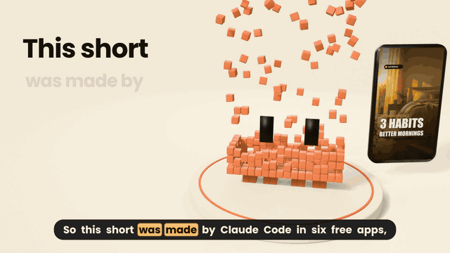

# Claude Code × Craft Studio: set up 13 free creative and office apps in one conversation

<p align="center">
  <a href="media/claude-code-craft-studio.mp4"></a>
</p>

<p align="center">
  ▶ <a href="media/claude-code-craft-studio.mp4">Watch 30 s with sound (MP4)</a> ·
  📘 <a href="https://qualixar.com/learn/guides/claude-code-6-free-adobe-alternatives">Free 16-page guide on qualixar.com</a>
</p>

For people who work with photos, sound, video, or documents every day and have
never opened a terminal. You end up with free apps that stand in for Photoshop,
Lightroom, Illustrator, After Effects, Premiere, a music studio, Acrobat,
Word, Excel, PowerPoint, InDesign, Figma and CAD — and an assistant (Claude
Code) that can work them for you. Everything comes from the apps' official
GitHub pages. Nothing is installed without asking you first.

**What you need:** a Mac (Windows: not yet tested), Claude Code installed,
about 20 minutes, about 1 GB of disk for all 13 apps.

## Creator path (no terminal)

Open Claude Code, paste the prompt in [GUIDE-PROMPT.md](GUIDE-PROMPT.md),
press Enter, and answer its questions. It installs the `craft-studio` plugin
and runs `/craft-setup`, which walks you through each step and asks before
every install.

One-step install (Claude Code 2.1.275+):

```
/plugin install craft-studio --marketplace qualixar/craft-studio-setup
```

## Developer path (terminal)

```bash
git clone https://github.com/qualixar/craft-studio-setup.git
cd craft-studio-setup
bash scripts/install.sh --group all --yes
```

Useful flags: `--group creator|office|all` (default `all`), `--only <app>`,
`--mcp-only --workspace <dir>` (register MCP servers without reinstalling),
`--detect-only` (print what is already installed, change nothing),
`--skip-mcp`, `--reinstall`. See `scripts/install.sh --help`.

What the script does per app: download the pinned release zip from
`github.com/storytold/<app>`, check its SHA-256 fingerprint against
[catalog/apps.json](catalog/apps.json) (**aborts on mismatch**), unzip to
`~/tools/craft/<app>/`, symlink the CLI into `~/.local/bin`, register it with
`claude mcp add` at user scope, then verify `<app>-cli --version` and
`claude mcp list`. Re-running is safe: installed apps are skipped.

## The 13 apps

Creator pack (6): PhotoCraft, VectorCraft, FilmCraft, LightCraft, EffectCraft,
SoundCraft. Office pack (7): PDFCraft, WordCraft, GridCraft, DeckCraft,
DesignCraft, FigCraft, CADCraft. Versions, fingerprints and MCP flags:
[catalog/apps.json](catalog/apps.json). Groups: [catalog/groups.json](catalog/groups.json).

## Words explained (one line each)

- **Terminal** — the app where you type commands as text.
- **CLI** — a program you run by typing its name, no windows or buttons.
- **MCP** — the plug socket that lets Claude Code operate an app.
- **Skill** — a built-in instruction card Claude Code follows for a task.
- **PATH** — the list of folders your Mac searches for typed commands.
- **Install** — copying a program where your Mac can find it.

## What can go wrong

- A fingerprint mismatch: the script stops and installs nothing. Report it (see SECURITY.md).
- macOS asks once before opening a downloaded app: normal. The apps are signed and notarized (see SIGNING.md); approve once in the dialog or System Settings.
- FilmCraft's MCP has no folder confinement: point it at a scratch project.

## Tests

```bash
bash tests/test_install.sh   # temp HOME + fake catalog; 13 checks, no network beyond localhost
```

## Licence

MIT — see [LICENSE](LICENSE).
