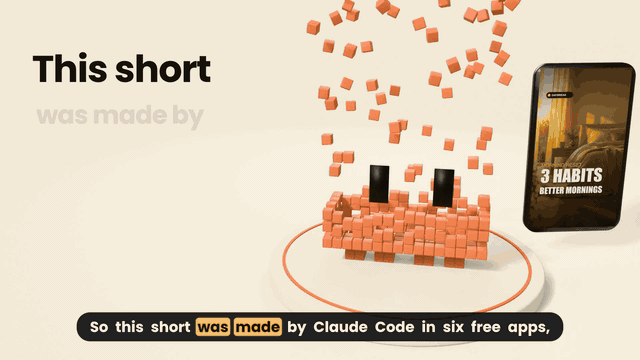

# Claude Code × Craft Studio: set up 13 free creative and office apps in one conversation

<p align="center">
  <a href="media/claude-code-craft-studio.mp4"></a>
</p>

<p align="center">
  ▶ <a href="media/claude-code-craft-studio.mp4">Watch 30 s with sound (MP4)</a> ·
  📘 <a href="https://qualixar.com/learn/guides/claude-code-6-free-adobe-alternatives">Free 16-page guide on qualixar.com</a>
</p>

For people who work with photos, sound, video, or documents every day and have
never opened a terminal. You end up with free apps that stand in for Photoshop,
Lightroom, Illustrator, After Effects, Premiere, a music studio, Acrobat,
Word, Excel, PowerPoint, InDesign, Figma and CAD: and an assistant (Claude
Code) that can work them for you. Everything comes from the apps' official
GitHub pages. Nothing is installed without asking you first.

**What you need:** a Mac, Claude Code installed, and Python 3 (available with
Apple's Xcode Command Line Tools: `xcode-select --install`). Allow time for
roughly 1.1 GB of CLI downloads and 2.2 GB for the extracted tools. Keep at
least 4 GB free for the tools, download cache and temporary extraction.
The optional desktop apps need additional download and disk space.

This repo's installer is **Mac-only**. Windows installers exist in the
[upstream releases](https://github.com/storytold/wordcraft/releases), but this
setup flow has not been tested on Windows.

## Creator path (no terminal)

Open Claude Code, paste the prompt in [GUIDE-PROMPT.md](GUIDE-PROMPT.md),
press Enter, and answer its questions. It installs the `craft-studio` plugin
and runs `/craft-setup`, which walks you through each step and asks before
every install.

The commands shown in Episode 1 still work in plugin v0.2.0:

```
/plugin marketplace add qualixar/craft-studio-setup
/plugin install craft-studio@craft-studio-setup
/craft-setup
```

## Developer path (terminal)

```bash
git clone https://github.com/qualixar/craft-studio-setup.git
cd craft-studio-setup
bash scripts/install.sh --group all --yes
```

Useful flags: `--group creator|office|all` (default `all`), `--only <app>`,
`--mcp-only --workspace <dir>` (register MCP servers without reinstalling),
`--detect-only` (print what is already installed, change nothing),
`--skip-mcp`, `--reinstall`. See `scripts/install.sh --help`.

To also install the desktop apps so you can open the files yourself:

```bash
bash scripts/install.sh --group all --yes --desktop
```

The default installs CLI tools only. `--desktop` verifies each DMG's pinned
SHA-256 before mounting it read-only, copies its `.app` to `/Applications`,
then detaches it. No `sudo` is used. If your account cannot write there, use
`--desktop-dir "$HOME/Applications"`. The same flag accepts a temporary target
for tests. An existing app with the same name is replaced; quit it first.
Re-running with `--desktop` works even if the CLI is already installed.

To check each selected CLI's MCP initialize handshake and tool list without
registering any servers or changing Claude's configuration:

```bash
bash scripts/install.sh --group office --verify-mcp
```

`--verify-mcp` uses the catalog's launch arguments and workspace. It needs the
CLIs installed first. `--mcp-only` continues to register them with Claude Code.

What the script does per app: download the pinned release zip from
`github.com/storytold/<app>`, check its SHA-256 fingerprint against
[catalog/apps.json](catalog/apps.json) (**aborts on mismatch**), unzip to
`~/tools/craft/<app>/`, symlink the CLI into `~/.local/bin`, register it with
`claude mcp add` at user scope, then verify `<app>-cli --version` and
`claude mcp list`. Re-running skips CLIs already at the pinned version and
upgrades older versions. If a server fails to connect, is missing from the
health output, or the health command fails, the installer names the problem
and exits with status 2.

## The 13 apps

Creator pack (6): PhotoCraft, VectorCraft, FilmCraft, LightCraft, EffectCraft,
SoundCraft. Office pack (7): PDFCraft, WordCraft, GridCraft, DeckCraft,
DesignCraft, FigCraft, CADCraft. Pinned releases from 31 October 2026:

| App | Version |
| --- | --- |
| photocraft | 0.18.0 |
| vectorcraft | 0.19.0 |
| filmcraft | 0.15.0 |
| lightcraft | 0.16.0 |
| effectcraft | 0.19.0 |
| soundcraft | 0.15.0 |
| pdfcraft | 0.16.1 |
| wordcraft | 0.13.2 |
| gridcraft | 0.14.2 |
| deckcraft | 0.13.1 |
| designcraft | 0.15.2 |
| figcraft | 0.13.1 |
| cadcraft | 0.15.1 |

Fingerprints, desktop DMGs and MCP launch arguments:
[catalog/apps.json](catalog/apps.json). Groups: [catalog/groups.json](catalog/groups.json).

## Words explained (one line each)

- **Terminal**: the app where you type commands as text.
- **CLI**: a program you run by typing its name, no windows or buttons.
- **MCP**: the plug socket that lets Claude Code operate an app.
- **Skill**: a built-in instruction card Claude Code follows for a task.
- **PATH**: the list of folders your Mac searches for typed commands.
- **Install**: copying a program where your Mac can find it.

## What can go wrong

- A fingerprint mismatch: the script stops before extracting or mounting that download. Earlier successful app installs remain. Report it (see SECURITY.md).
- A command is missing after install: add `export PATH="$HOME/.local/bin:$PATH"` to your shell profile, then open a new terminal. MCP registration uses absolute paths and does not depend on this.
- A GitHub download fails: re-run the same command. Partial downloads are discarded and completed cached files are checked again.
- macOS can ask before opening downloaded software. Review the publisher shown in the dialog; [SIGNING.md](SIGNING.md) records the checks and their dates.
- Folder access varies by app. FilmCraft, GridCraft and CADCraft currently have no folder restriction flags in this catalog; use a scratch project and review MCP permissions. The workspace setting is not a universal sandbox.

## Tests

```bash
bash tests/test_install.sh   # temp HOME, fake ZIP/DMG/download/MCP fixtures; no network
claude plugin validate .
```

## Licence

MIT: see [LICENSE](LICENSE).
